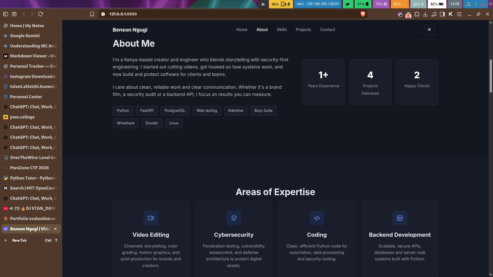
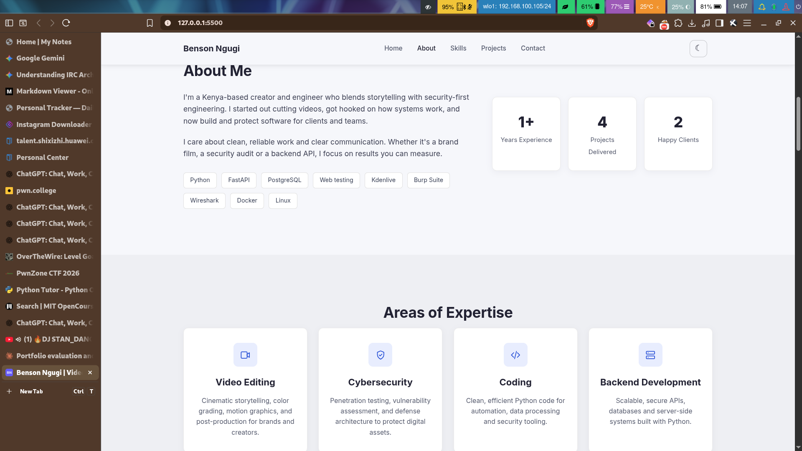

<div align="center">

# Benson Ngugi | Portfolio

**Web Application Security · Penetration Testing · Video Editing (hobby)**

A fast, accessible, responsive personal portfolio built with plain HTML, CSS and JavaScript.


[**Report a Bug**](../../issues) · [**Contact**](mailto:ngugibenson@proton.me)

</div>

---

<div align="center">

| Dark | Light |
|:---:|:---:|
|  |  |

</div>

## Overview

This repository contains the source for my personal portfolio website. It showcases my web application security work, with video editing as a hobby, and gives employers and clients an easy way to get in touch.

The site is a static page with **no framework, no build step and no dependencies**, so it loads quickly and can be hosted anywhere for free.

## Features

- **Dark and light themes** with a toggle; the choice is saved and applied before first paint
- **Responsive layout** from large desktops down to small phones, with an accessible mobile menu
- **Security write-ups**: six standalone pages in `writeups/` (access control, SSRF, IDOR/BOLA, indirect prompt injection and tool misuse, business logic and race conditions, broken authentication and OAuth)
- **Security projects** with a category filter (Recon, Labs, Auth, AI/LLM, Detection, Reporting) and a small video editing hobby section
- **Scroll-spy navigation** that highlights the current section
- **Downloadable CV** and a **contact form** that opens the visitor's email app with the message pre-filled
- **Accessibility:** skip link, keyboard focus styles, ARIA states, and support for `prefers-reduced-motion`
- **Touch-friendly:** project links stay visible on devices without hover
- **Performance:** lazy-loaded images, system-font fallback, and no JavaScript libraries
- **SEO basics:** page title, meta description, Open Graph tags and favicon

## Tech stack

| | |
|---|---|
| **Markup** | HTML5 |
| **Styling** | CSS3 (Grid, Flexbox, media queries) |
| **Scripting** | Vanilla JavaScript (ES6+) |
| **Typeface** | [Inter](https://fonts.google.com/specimen/Inter) (Google Fonts) |

## Project structure

```
.
├── index.html        # Page content and structure
├── style.css         # Styles, light/dark themes, responsive rules
├── script.js         # Menu, theme toggle, project filter, scroll-spy, contact form
├── cv.pdf            # Downloadable CV-not available now
├── images/             # README screenshots
└── *.svg             # Contact icons
```


## Browser support

Latest versions of Chrome, Edge, Firefox and Safari on desktop and mobile.

## Contact

**Benson Ngugi**

- GitHub: [@enmessara](https://github.com/enmessara)
- Email: [ngugibenson@proton.me](mailto:ngugibenson@proton.me)
- Location: Meru, Kenya

## License

&copy; 2026 Benson Ngugi. All rights reserved.
